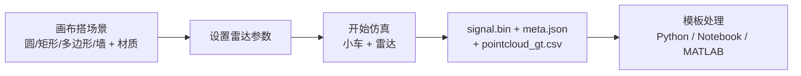
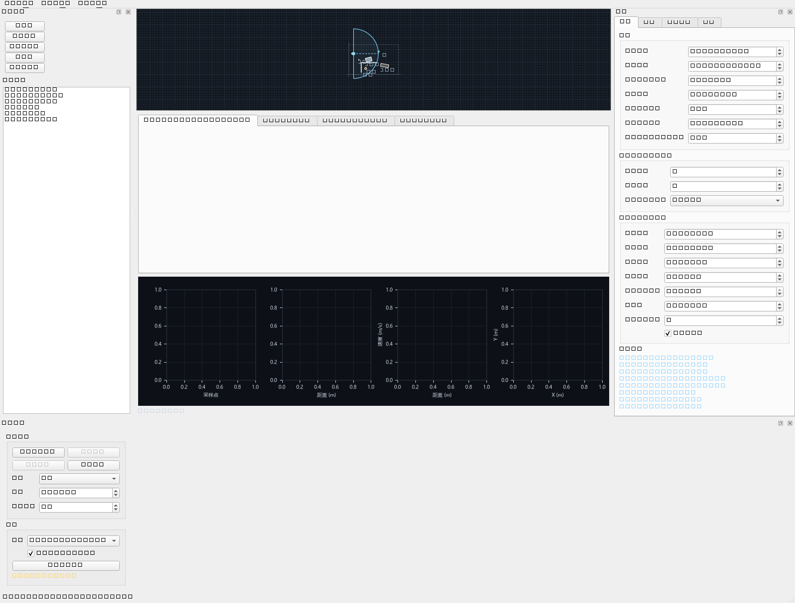

# 2D 场景雷达仿真器

在 2D 俯视平面上搭场景、配雷达、开车跑仿真，导出**波形级 FMCW 原始 IQ 二进制**，并用自带模板一键跑通「二进制 → 距离-多普勒 → CFAR → 点云 → 与真值对比」。





## 下载

不装 Python 也能用。下载 [最新 Release](../../releases/latest) 里的：

| 附件 | 体积 | 说明 |
| --- | --- | --- |
| `radar-sim-<版本>-win64.zip` | 83 MB | 解压后双击 `雷达仿真器.exe`；启动快，`templates/`、`examples/` 可以随手改 |

`SHA256SUMS.txt` 是同目录的校验值。每个包在生成时都会真的建窗口、跑完仿真、导出数据再用模板读回来，任何一项不过就不会发出来。

exe 不进源码仓库——由 [`.github/workflows/release.yml`](.github/workflows/release.yml) 在打 tag 时自动构建并挂到 Release。

## 安装

要跑源码或模板，则需要 Python：

```bash
python -m venv .venv
.venv/Scripts/python -m pip install -e .      # Windows
# source .venv/bin/activate && pip install -e .   # Linux/macOS
```

## 打包成 exe

```bash
.venv/Scripts/python -m pip install -e ".[packaging]"
.venv/Scripts/python packaging/build.py
```

产出 `dist/雷达仿真器/`，双击里面的 `雷达仿真器.exe` 即可。附带命令行版 `radar-sim-cli.exe`、处理模板、示例场景和使用说明。

| | 文件夹版 | 单文件版 |
| --- | --- | --- |
| 体积 | 177 MiB | **71.7 MiB** |
| 进程就绪 | 约 1 s | **2.8 s**（含解压归档） |
| 完整自检 | 9.0 s | 8.5 s |
| 模板可编辑 | ✅ | ❌ 封在归档里 |

单文件版比预想的小很多（归档压缩率很高），启动代价也只在 2–3 秒量级。

每次构建后会自动跑一遍**冻结包自检**——真的建窗口、跑完 50 帧、导出并用模板读回，任何一项失败就报告失败。普通用户也可以双击 `运行自检.cmd` 自测。

细节见 [`packaging/README.md`](packaging/README.md)。

不想每次手动打包：给 `main` 推一个 tag（如 `v0.1.0`），GitHub Actions 会跑同一套流程并把产物挂到 Release。
打 tag 前把 [`src/radar_sim/__init__.py`](src/radar_sim/__init__.py) 的 `__version__` 改成同一个版本号——
不一致时打包脚本会警告，否则 exe 的 `--version` 会打出旧版本。

## 快速开始

### 图形界面

```bash
python -m radar_sim.main                # 打开内置示例场景
python -m radar_sim.main --empty        # 从空白场景开始
python -m radar_sim.main --scene examples/scenes/corridor.scene.json
```

操作：左侧选形状 → 画布点击放置 → 右侧「图元属性」改几何与材质 → 「雷达」页调参数 → 底部「▶ 开始仿真」→ 方向键/WASD 驾驶 → 「💾 导出数据」。

### 命令行（无界面批量生成）

```bash
# 内置示例，20 帧
radar-sim-cli --demo --out dataset/demo --frames 20

# 用示例场景，开二次反射多径
radar-sim-cli --scene examples/scenes/corridor.scene.json --out dataset/corridor --order 2

# 只看看参数与派生指标，不生成数据
radar-sim-cli --demo --inspect

# 材质预设表
radar-sim-cli --list-materials
```

### 处理数据

不用装 Python，exe 自己就能处理（推荐）：

```bash
radar-sim-cli.exe --process dataset/demo --out figures    # 出四张图
radar-sim-cli.exe --compare dataset/demo --out .          # 与真值对比
```

或者用模板源码（就是上面两条命令跑的同一份代码，可直接拷进你自己的项目）：

```bash
cd templates/python
python process_demo.py --data ../../dataset/demo --out figures
python compare_gt.py   --data ../../dataset/demo --frames 20
```

实测精度（示例场景，20 帧，$P_{fa}=10^{-3}$）：

| 指标 | RMS | 备注 |
| --- | --- | --- |
| 距离 | 0.106 m | 小于 $\Delta R$ = 0.195 m |
| 速度 | 0.029 m/s | 小于 $\Delta v$ = 0.094 m/s |
| 方位 | 0.59° | 远小于 9.55° 角分辨率 |
| 虚警率 | 1.9% | 设定 $P_{fa}$ = 0.1% |

## 默认雷达配置（对齐 TI IWR1843）

| 参数 | 值 | | 派生指标 | 值 |
| --- | --- | --- | --- | --- |
| 载频 | 77 GHz | | 距离分辨率 | 0.195 m |
| 调频斜率 | 29.982 THz/s | | 最大距离 | 50.0 m |
| 扫频时间 $T_r$ | 60 µs | | 最大不模糊速度 | ±6.01 m/s |
| chirp 周期 $T_c$ | 160 µs | | 速度分辨率 | 0.094 m/s |
| 采样 $N_s$ / chirp 数 $N_c$ | 256 / 128 | | 角分辨率 | 9.55° |
| 阵元 | 3 TX × 4 RX = 12 虚拟 | | 单帧数据量 | 1.5 MiB |

全部参数可在界面里改，面板会实时显示派生指标与参数冲突警告。

## 输出

| 文件 | 内容 |
| --- | --- |
| `signal.bin` | 无文件头的 int16 复数 IQ。**两种布局**：`ti_dca1000`（默认，兼容 TI `readDCA1000.m`）与 `interleaved_iq` |
| `meta.json` | 雷达参数、派生指标、场景快照、车辆轨迹、逐帧字节偏移 |
| `pointcloud_gt.csv` | 理想点云真值（含多径路径） |
| `README.txt` | 该次导出的解析示例 |

`signal.bin` 布局、约定与常见坑见 [`templates/python/README.md`](templates/python/README.md) 与 [`docs/DESIGN.md`](docs/DESIGN.md) 第 8 / 10.6 节。

## 目录

```
src/radar_sim/
├─ core/          仿真内核（不依赖 Qt，可无界面运行）
│  ├─ geometry.py      射线/线段求交、镜像、多边形
│  ├─ scene.py         图元、材质、场景 JSON
│  ├─ scatterers.py    图元 → 散射点离散化
│  ├─ raytrace.py      遮挡判定 + 镜像法多径（≤2 次反射）
│  ├─ radar.py         FMCW IQ 合成 + 热噪声 + 真值表
│  ├─ framing.py       标准距离/速度/角度轴、距离-多普勒
│  ├─ detection.py     CA-CFAR、FFT 测角、点云
│  ├─ vehicle.py       运动学自行车 + 纯追踪
│  ├─ simulator.py     帧调度、导出
│  └─ io_export.py     双布局打包、meta.json
├─ ui/            PySide6 界面（画布、面板、信号视图）
├─ selftest.py    冻结包自检（--selftest）
├─ cli.py         无界面批量生成
└─ main.py        GUI 入口
templates/        Python / Jupyter / MATLAB 处理模板
examples/scenes/  示例场景
packaging/        打包成 exe（build.py / radar_sim.spec / make_icon.py）
scripts/          bench.py 性能探针、acceptance.py 端到端验收
docs/DESIGN.md    设计文档（参数、算法、格式、验收标准、打包）
.github/          release.yml：打 tag 自动打包并发 Release
```

## 物理模型

- **材质 → 回波**：镜面 + 朗伯双分量
  $a(\psi) = \rho(1-\tau)\left[(1-\eta)e^{-\psi^2/2\sigma_\psi^2} + \eta\cos\psi\right]10^{-A/20}$
  → 正对雷达的金属板很亮、斜 30° 迅速变暗、植被弱而各向均匀。
- **多径**：镜像法精确求解镜面反射，默认 1 次，可开 2 次。幽灵目标距离**长于**真实直线距离。
- **遮挡**：不透明材质完全阻挡；透射材质按 $\sqrt{\tau}$ 衰减。
- **噪声**：按 $kT_0 B \cdot NF \cdot L$ 计算热噪声功率，与信号同尺度，因此**原始 IQ 的 SNR 很低**（示例场景约 0 dB/采样），距离 FFT 提供约 21 dB 处理增益后才可检测——这与真实雷达一致。

## 测试

```bash
QT_QPA_PLATFORM=offscreen python -m pytest        # 244 项
```

覆盖：几何求交、场景序列化、遮挡与多径（含解析解校验）、IQ 合成与雷达方程、确定性（同 seed 逐字节一致）、双布局互换、车辆运动学、GUI 冒烟（离屏）、模板与内核公式一致性。

另有一个可读的端到端验收脚本，它会真的建窗口、编辑场景、跑完 50 帧、导出数据集：

```bash
QT_QPA_PLATFORM=offscreen python scripts/acceptance.py
```

## 文档

- [`docs/DESIGN.md`](docs/DESIGN.md) — 完整设计文档：参数表、算法、`signal.bin` 字节级布局、`meta.json` schema、界面规格、17 条验收测试、防坑清单
- 运行 `radar-sim-cli --help` 查看全部命令行参数
