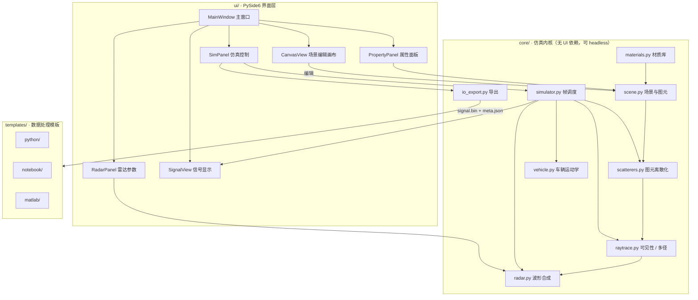
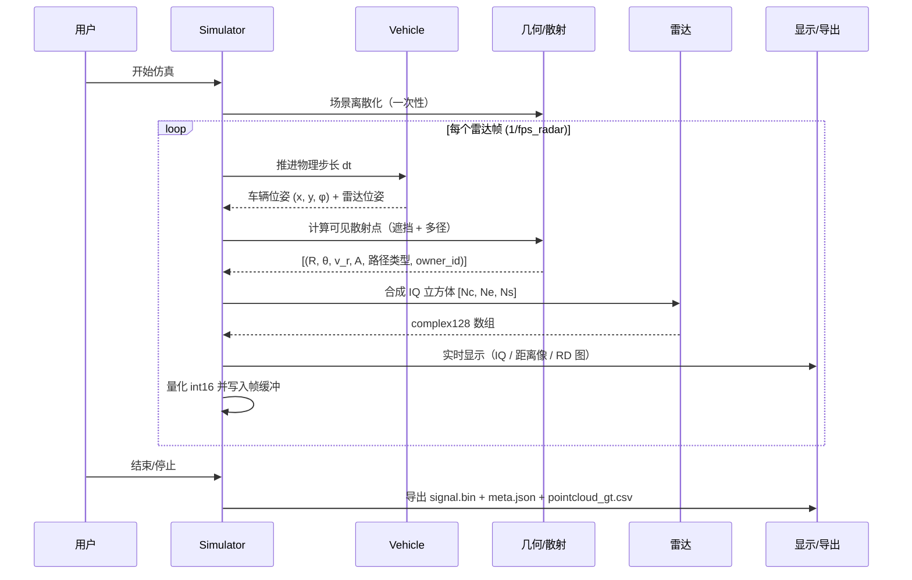

# 2D 场景雷达仿真器 — 开发设计文档

| 项目 | 内容 |
| --- | --- |
| 文档版本 | v0.2 |
| 状态 | 核心约定已定；Q1–Q4 已确认，其余问题按默认方案实现 |
| 技术栈 | Python 3.11+ / PySide6 / NumPy / Matplotlib / SciPy |
| 雷达体制 | FMCW 调频连续波（波形级仿真）+ 理想点云真值 |
| 默认雷达配置 | TI IWR1843 实测配置：77 GHz / S=29.982 THz/s / Tr=60 µs / Tc=160 µs / 256×128 / 3TX×4RX |
| 电磁模型 | 镜像法射线追踪，最多 2 次反射（镜面 + 漫散射双分量） |
| 输出 | `signal.bin`（int16，支持 TI DCA1000 原生布局与简化交错 IQ 双格式）+ `meta.json` + `pointcloud_gt.csv` |
| 参考项目 | `使用过的作业文件\26.5\SLAM`（MATLAB 雷达仿真链）——已逐文件评审，其 20 处缺陷与本项目的规避方式见 §10.6 |

---

## 1. 项目目标

做一个 **2D 俯视平面场景的雷达仿真器**，用户通过可视化界面完成：

1. **搭建场景**：在画布上放置/编辑几何形状（圆、矩形、多边形、墙），并为每个形状设置**材质**与**材质参数**（反射率、粗糙度、透射率、吸收等）。
2. **配置雷达**：调整 FMCW 体制的载频、带宽、chirp 数、阵元数、发射功率等全部参数。
3. **配置车辆**：调整小车尺寸、动力性能，并绘制行驶路径。
4. **开始仿真**：点击"开始仿真"，出现一辆可平面移动的小车，车上雷达持续工作并实时显示信号。
5. **导出数据**：仿真结束后导出**雷达原始二进制信号**，供用户用自己的算法处理。
6. **模板验证**：自带 Python / Jupyter / MATLAB 数据处理模板，用户可一键跑通"二进制 → 距离-多普勒 → CFAR → 点云 → 成像"，立即看到效果。

### 1.1 非目标（本期不做）

- 3D 场景与三维成像（仅 2D 俯视切面）。
- 真实电磁场求解（FDTD / MoM）、真三维 RCS 方向图。
- 多雷达协同、通信/干扰、SAR 成像。
- 实时硬件接口（仅文件导出）。

### 1.2 术语表

| 术语 | 含义 |
| --- | --- |
| 图元 Primitive | 场景中的基本几何体（圆 / 矩形 / 多边形 / 墙段） |
| 散射点 Scatterer | 图元离散化后用于回波合成的点目标，是仿真最小单元 |
| chirp | 一次线性调频扫频 |
| 帧 Frame | 一个雷达数据立方体 = `Nc × Ne × Ns` 个复数采样 |
| RD 图 | 距离-多普勒图（Range-Doppler Map） |
| 快时间 / 慢时间 | 单 chirp 内采样轴 / 跨 chirp 轴 |

---

## 2. 坐标系与单位约定

- **平面坐标系**：右手系俯视图。$X$ 轴向右（东），$Y$ 轴向上（北），$Z$ 轴垂直纸面向外（仅用于定义"法向/朝向"，不参与计算）。
- **单位**：长度 `m`，速度 `m/s`，角度存储为 `rad`、界面显示为 `deg`，时间 `s`，频率 `Hz`。
- **方位角** $\theta$：从 $+X$ 轴逆时针为正，范围 $(-\pi, \pi]$；即东为 $0$，北为 $+\pi/2$。
- **朝向角** $\phi$：车辆/雷达的朝向，定义同上。
- **坐标系原点**：场景左上角为画布原点，世界坐标 $(0,0)$ 位于画布左下角；世界 $Y$ 轴向上，画布屏幕 $Y$ 轴向下（视图做翻转，`QGraphicsView.scale(1, -1)` 方案）。
- **数值精度**：内部一律 `float64` / `complex128`，导出时才量化到 `int16`。

### 2.1 全局约定（单一真源）

> **教训来源**：参考项目 SLAM 的同一个 MATLAB 工程里并存了 2~3 套维度顺序、两套相位符号、两套带宽口径，导致 `main.m` 根本无法串起来运行。本项目必须**单一真源 + 加载即断言**。

下表是**全项目唯一真源**，UI、仿真内核、导出、三套模板必须完全一致；任何一处偏离即视为 bug。

| 约定项 | 规定 | 落地方式 |
| --- | --- | --- |
| 数组维度顺序 | `(Nc, Nv, Ns)` = (chirp, 虚拟阵元, 采样) | 所有公开 API 统一；写入 `meta.json` 的 `axis_order` |
| 快时间（距离）轴 | 最后一维 | `load_frame()` 返回前 `assert cube.shape == (Nc,Nv,Ns)` |
| 慢时间（多普勒）轴 | 第 0 维 | |
| 空间（角度）轴 | 第 1 维 | |
| 回波相位 | $\varphi = 4\pi R/\lambda$，$R$ 增大则 $\varphi$ 增大 | 单元测试直接对比解析式 |
| 径向速度符号 | **正 = 远离雷达**；正速度峰值出现在 `fftshift` 后 RD 图的**上半部** | 测试 T16 |
| 方位角 | 从 $+X$ 轴逆时针，$(-\pi,\pi]$；右侧为正 | |
| 分辨率带宽口径 | 距离分辨率**必须**用有效带宽 $B_{valid}=S N_s/f_s$ | 断言 $\Delta R \equiv c f_s/(2SN_s)$ |
| 最大距离口径 | **必须**用 $f_s$：$R_{\max}=c f_s/(2S)$ | |
| FFT 零频 bin | `fftshift` 后零频在 0-based 索引 $N/2$ | 测试 T15 |
| 窗函数 | 一律 periodic：`hann(N+1)[:-1]` | 禁止 symmetric |
| 随机数 | 一律 `np.random.default_rng(seed)`，seed 写入 `meta.json` | 测试 T9 |
| 数值格式 | 内部 `float64`/`complex128`，仅导出量化 | |

---

## 3. 系统架构



**分层原则**：`core/` 不导入任何 `PySide6`，保证可以跑无界面批处理（数据集生成）。UI 只通过 `Simulator` 的公开接口交互。

### 3.1 目录结构

```
场景模拟器/
├─ docs/
│  └─ DESIGN.md                     # 本文档
├─ README.md
├─ pyproject.toml
├─ requirements.txt
├─ src/radar_sim/
│  ├─ __init__.py
│  ├─ main.py                       # GUI 入口
│  ├─ cli.py                        # 无界面批处理入口
│  ├─ core/
│  │  ├─ geometry.py                # 向量运算、射线-线段求交、镜像
│  │  ├─ scene.py                   # Scene / Primitive / MaterialRef
│  │  ├─ materials.py               # 材质预设库
│  │  ├─ scatterers.py              # 图元 → 散射点集
│  │  ├─ raytrace.py                # 遮挡判定 + 镜像法多径
│  │  ├─ radar.py                   # RadarConfig + IQ 合成
│  │  ├─ vehicle.py                 # 车辆运动学 + 路径跟随
│  │  ├─ simulator.py               # 仿真主循环 / 帧调度
│  │  └─ io_export.py               # signal.bin / meta.json / csv
│  └─ ui/
│     ├─ main_window.py
│     ├─ canvas_view.py             # QGraphicsView + 网格/标尺
│     ├─ scene_items.py             # 可拖拽/缩放的图元 Item
│     ├─ property_panel.py
│     ├─ radar_panel.py
│     ├─ vehicle_panel.py
│     ├─ sim_panel.py
│     └─ signal_view.py             # IQ / 距离像 / RD 图 / 点云
├─ templates/
│  ├─ python/
│  │  ├─ radar_io.py                # 读 signal.bin + meta.json
│  │  ├─ process_demo.py            # 端到端处理示例
│  │  ├─ requirements.txt
│  │  └─ README.md
│  ├─ notebook/
│  │  └─ 雷达数据处理教学.ipynb      # 分步讲解
│  └─ matlab/
│     ├─ read_signal.m
│     ├─ range_doppler_cfar.m
│     └─ demo.m
├─ examples/scenes/*.scene.json
└─ tests/
```

---

## 4. 场景模型

### 4.1 图元类型

| 类型 | 参数 | 生成边（供射线求交） |
| --- | --- | --- |
| `circle` | `x, y, r` | 内接多边形（默认 64 段可配） |
| `rect` | `x, y, w, h, rot` | 4 条边 |
| `polygon` | `points[], rot` | 各条边（凸/凹均支持） |
| `wall` | `points[]`（折线）, `thickness` | 折线各段 + 两端封口 |

- 所有图元都有 `id`（UUID）、`name`、`layer`（z 序）、`visible`、`locked`。
- 图元支持：拖动移动、顶点编辑（多边形）、角点缩放（矩形/圆）、旋转手柄。
- 吸附：网格吸附（默认 1 m）、顶点吸附、正交吸附（Shift）。

### 4.2 材质参数定义

每个图元引用一个材质（或使用自定义材质）。材质参数直接影响雷达回波：

| 参数 | 符号 | 范围 | 默认 | 物理含义 |
| --- | --- | --- | --- | --- |
| 反射率 | $\rho$ | 0 – 1 | 0.7 | 表面反射幅度系数，1 = 完美导体 |
| 粗糙度 | $\eta$ | 0 – 1 | 0.3 | 0 = 全镜面（平板正对时强闪），1 = 全漫散射（朗伯） |
| 透射率 | $\tau$ | 0 – 1 | 0.0 | 0 = 完全不透（遮挡），1 = 完全透射（不遮挡不反射） |
| 吸收损耗 | $A$ | 0 – 40 dB | 0 | 每次反射的能量附加损耗 |
| 反射附加相位 | $\varphi_\rho$ | −180° – 180° | 0° | 反射引起的常数相位偏移 |
| 镜面窗口 | $\sigma_\psi$ | 1° – 45° | 8° | 镜面分量随入射角衰减的高斯宽度 |
| 穿透损耗 | $L_t$ | 0 – 60 dB/m | 20 | 穿透非透明材质时的单程损耗 |

**材质预设库**（可编辑、可新增、可保存到用户目录）：

| 预设 | ρ | η | τ | 说明 |
| --- | --- | --- | --- | --- |
| 金属板 | 0.95 | 0.05 | 0.0 | 强镜面反射，正对时极亮 |
| 混凝土墙 | 0.45 | 0.55 | 0.0 | 中等反射、较粗糙 |
| 玻璃 | 0.25 | 0.10 | 0.85 | 大部分透射 |
| 木板 | 0.30 | 0.70 | 0.0 | 弱反射、强漫散射 |
| 人体 | 0.35 | 0.60 | 0.0 | 类圆柱目标 |
| 植被/灌木 | 0.12 | 0.95 | 0.0 | 极弱且高度漫散射 |
| 吸波材料 | 0.02 | 0.90 | 0.0 | 近似雷达隐身 |
| 自定义 | — | — | — | 用户自由设置 |

### 4.3 材质如何影响"雷达敏感度"（核心公式）

设表面法向为 $\hat{n}$，雷达入射方向单位向量为 $\hat{u}$（由表面指向雷达），入射角
$\psi = \arccos(\hat u \cdot \hat n)$（$0$ = 正对）。

**双分量半经验散射模型**（镜面 + 朗伯漫散射），返回雷达方向的等效反射幅度：

$$
a(\psi) = \rho\,(1-\tau)\left[\, w_s \exp\!\left(-\frac{\psi^2}{2\sigma_\psi^2}\right) + w_d \cos\psi \,\right] \cdot 10^{-A/20}
$$

其中镜面权重 $w_s = 1-\eta$，漫散射权重 $w_d = \eta$，相位附加 $\varphi_\rho$。

直观解释：
- **正对雷达的金属平板** → $\psi\approx 0$，镜面项满值 → 极强回波（"闪烁"）。
- **斜放金属板** → $\psi$ 大，镜面项指数衰减，只剩 $w_s\approx0$、$w_d$ 很小 → 回波骤降。
- **植被** → $\rho$ 小且 $\eta\approx1$ → 弱但各方向均匀的漫散射。

> 该模型是 2D 平面内的工程近似，不追求电磁严格性，但能稳定复现"材质 → 回波强弱"的可感知差异。第 14 章 Q4 请你确认是否接受。

### 4.4 场景文件格式 `.scene.json`

```json
{
  "version": "1.0",
  "units": {"length": "m", "angle": "deg"},
  "bounds": {"width": 100.0, "height": 60.0},
  "materials": [
    {"id": "metal", "name": "金属板", "rho": 0.95, "eta": 0.05, "tau": 0.0,
     "absorption_db": 0.0, "phase_deg": 0.0, "sigma_psi_deg": 8.0, "penetration_db_per_m": 20.0}
  ],
  "primitives": [
    {"id": "p1", "type": "rect", "name": "建筑A", "material_id": "metal",
     "layer": 0, "visible": true, "locked": false,
     "x": 40.0, "y": 30.0, "w": 12.0, "h": 8.0, "rot": 15.0},
    {"id": "p2", "type": "circle", "name": "树", "material_id": "vegetation",
     "layer": 1, "visible": true, "locked": false,
     "x": 60.0, "y": 20.0, "r": 1.5}
  ],
  "vehicle": {
    "start": {"x": 5.0, "y": 10.0, "phi_deg": 0.0},
    "length": 4.5, "width": 1.9, "wheelbase": 2.7,
    "max_speed": 15.0, "max_accel": 3.0, "max_steer_deg": 35.0,
    "radar_offset": {"x": 1.5, "y": 0.0},
    "mode": "manual",
    "path": [{"x": 5.0, "y": 10.0}, {"x": 60.0, "y": 10.0}, {"x": 60.0, "y": 45.0}],
    "path_speed": 6.0
  },
  "radar": { "...": "见 5.1 参数表" },
  "simulation": {
    "seed": 42, "fps_render": 60, "frame_period_s": 0.08,
    "duration_s": 4.0, "enable_noise": true, "enable_multipath": true
  }
}
```

---

## 5. 雷达模型

### 5.1 参数表（全部可在 UI 调整）

**默认值对齐 TI IWR1843 实测配置**（与参考项目 `radar_constants.m` 一致）。

| 参数 | 符号 | 默认值 | 可选范围 | 单位 | 说明 |
| --- | --- | --- | --- | --- | --- |
| 起始频率 | $f_{start}$ | 77.0 | 1 – 100 | GHz | 预设 24 / 60 / 77 / 79 |
| 扫频斜率 | $S$ | 29.982 | 1 – 100 | THz/s | **直接给斜率**，比给带宽更贴近硬件配置 |
| 扫频时间 | $T_r$ | 60 | 20 – 500 | µs | 单个 chirp 的调频时长 |
| 空闲时间 | $T_{idle}$ | 100 | 10 – 500 | µs | |
| chirp 周期 | $T_c=T_r+T_{idle}$ | 160 | — | µs | 派生量，只读 |
| 每帧 chirp 数 | $N_c$ | 128 | 16 – 512 | — | 建议为 $N_t$ 的整数倍 |
| 每 chirp 采样点数 | $N_s$ | 256 | 32 – 1024 | — | 采样窗 $N_s/f_s$ 必须 ≤ $T_r$ |
| ADC 采样率 | $f_s$ | 10.0 | 1 – 50 | MHz | 需 $f_s \ge 2 f_{b,\max}$ |
| 发射阵元数 | $N_t$ | 3 | 1 – 8 | — | TDM-MIMO |
| 接收阵元数 | $N_r$ | 4 | 1 – 8 | — | |
| 虚拟阵元数 | $N_v=N_tN_r$ | 12 | — | — | 派生量，只读；**只取方位维**（见 §5.4） |
| 阵元间距 | $d$ | $\lambda/2$ = 1.926 | 0.1λ – 1λ | mm | 半波长，无栅瓣 |
| MIMO 模式 | — | `ideal` | `ideal` / `tdm` | — | 见 §5.4 |
| 发射功率 | $P_t$ | 12 | −10 – 30 | dBm | |
| 天线增益 | $G$ | 12 | 0 – 30 | dBi | 收发同增益 |
| 噪声系数 | $NF$ | 12 | 0 – 30 | dB | 决定噪声底 |
| 系统损耗 | $L$ | 3 | 0 – 20 | dB | |
| ADC 位宽 | — | 16 | 8 – 16 | bit | 存储统一 int16 |
| 接收机带宽 | $B_{rx}$ | 自动 = $f_s$ | — | MHz | 用于算噪声功率 |
| 帧周期 | $T_{frame}$ | 80 | 10 – 500 | ms | 需 $T_{frame} \ge N_c T_c$ |
| IQ 缩放 | `iq_scale` | 自适应 | 自适应/固定 | — | 见 §7.3 |
| 噪声开关 | — | 开 | — | — | |
| 多径开关 / 最大反射次数 | — | 开 / 2 | 0 – 2 | — | |

**派生指标（UI 实时显示，帮助用户理解参数含义）**：

| 指标 | 公式 | 默认值下 |
| --- | --- | --- |
| 波长 | $\lambda = c/f_{center}$ | 3.851 mm |
| 中心频率 | $f_{center} = f_{start} + S T_r/2$ | 77.90 GHz |
| 有效带宽 | $B_{valid} = S \cdot N_s/f_s$ | 767.5 MHz |
| 距离分辨率 | $\Delta R = \dfrac{c f_s}{2 S N_s} = \dfrac{c}{2B_{valid}}$ | **0.195 m** |
| 最大探测距离 | $R_{\max} = \dfrac{c f_s}{2S}$ | **50.0 m** |
| 距离 bin 宽 | $\dfrac{R_{\max}}{N_s}$ | 0.195 m |
| 同-TX chirp 间隔 | $T_c^{(tx)} = N_t T_c$（仅 `tdm` 模式） | 480 µs |
| 最大不模糊速度 | $v_{\max}=\pm\dfrac{\lambda}{4T_c^{(tx)}}$ | **±2.01 m/s（tdm）** / ±6.02 m/s（ideal） |
| 速度分辨率 | $\Delta v = \dfrac{\lambda}{2N_cT_c}$ | 0.094 m/s |
| 角分辨率（−3dB 近似） | $\approx \dfrac{2}{N_v}$ rad | 9.55° |
| 方位视场 | ±90°（半波长阵） | ±90° |
| 单帧数据量 | $4 N_c N_v N_s$ bytes | 1.5 MiB |
| 50 帧数据量（4 s @80 ms） | | 78.6 MB |

### 5.2 FMCW 信号模型

单个 chirp 的发射信号：

$$
s_{tx}(t) = \cos\!\left(2\pi\!\left(f_c t + \tfrac{S}{2}t^2\right)\right),\quad 0\le t<T_c
$$

散射点距离 $R$、径向速度 $v_r$，双程延时 $\tau = 2R/c$。混频后差拍信号（忽略残余视频相位）：

$$
s_{IF}(t) = A\,\exp\!\left[\, j2\pi\!\left(f_b\,t + \frac{2R}{\lambda}\right)\right],
\qquad f_b = \frac{2SR}{c} = S\tau
$$

离散化后，第 $m$ 个 chirp、第 $k$ 个接收阵元、第 $n$ 个采样点：

$$
\boxed{\;x[m,k,n] = A\cdot
\underbrace{e^{\,j2\pi \frac{f_b}{f_s} n}}_{\text{距离项（快时间）}}
\underbrace{e^{\,j2\pi \frac{2v_r}{\lambda} m T_c}}_{\text{多普勒项（慢时间）}}
\underbrace{e^{\,j2\pi \frac{d\,k\sin\theta}{\lambda}}}_{\text{角度项（阵列）}}
\;},\quad
f_d=\frac{2v_r}{\lambda}
$$

`eta=0`（完全镜面）时角度项按镜面几何计算；漫散射点时 $\theta$ 取该散射点相对雷达的方位角。

### 5.3 回波幅度（雷达方程）

$$
P_r = \frac{P_t G_t G_r \lambda^2 \sigma}{(4\pi)^3 R^4 L},
\qquad
A = \sqrt{\frac{P_r}{P_{ref}}}
$$

- $P_{ref}$ 为用户可设定的参考功率（默认 1 W，仅影响绝对幅度，不影响后续处理）。
- **2D 等效 RCS**：$\sigma = a(\psi)^2 \cdot A_{eff}$，其中 $a(\psi)$ 由 §4.3 给出，$A_{eff} = l_{seg} \cdot h_{eff}$ 为该散射点的等效散射面积（$l_{seg}$ 为离散段长度，$h_{eff}$ 为俯视切面等效高度，默认 1 m，可按图元类型配置）。
- 增益已按 $G$ 归一化，$G_t=G_r=10^{G/10}$。
- **噪声按单个散射点定义**：$\mathrm{SNR}_i = P_{r,i}/P_n$，逐点写入真值表；**禁止**用"所有目标之和的功率"定义全局 SNR（参考项目就因此导致目标数一变、单目标 SNR 全变）。

### 5.4 MIMO 模式与速度模糊（重要）

$N_t\times N_r$ 个虚拟阵元解决了角度分辨率，但**两种建模方式的多普勒标度完全不同**：

| 模式 | 含义 | 同阵元 chirp 间隔 | $v_{\max}$ | 适用场景 |
| --- | --- | --- | --- | --- |
| `ideal`（默认） | 假设 $N_v$ 个虚拟阵元每个都能取到完整 $N_c$ 个 chirp（相位中心法 / 理想 MIMO） | $T_c$ | ±6.02 m/s | 常规仿真，测速范围够用 |
| `tdm`（硬件保真） | 真实 AWR1843 的 TDM-MIMO：TX1/TX2/TX3 轮流发射，同一阵元每 $N_t$ 个 chirp 才出现一次 | $N_tT_c$ | ±2.01 m/s | 生成"像真硬件一样"的数据 |

- `tdm` 模式下**必须**在 `meta.json` 写 `tdm_interleave: true` 与 `chirps_per_tx = N_c/N_t`，模板需先按 TX 解交织、再在每个 TX 的 $N_c/N_t$ 个 chirp 上做多普勒 FFT。**否则速度会错 $N_t$ 倍**（参考项目 SLAM 正是踩了这个坑，且仿真数据与硬件行为不一致）。
- `ideal` 模式下各虚拟阵元 chirp 轴相同，直接按 $N_c$ 做多普勒 FFT。
- 当车辆速度超过 $v_{\max}$ 时，UI 参数面板给出**速度模糊警告**，并把超限的真值点标黄。
- **本项目 2D 方案只测方位角，不测俯仰角**——这同时天然规避了参考项目中"虚拟阵列几何自相矛盾导致俯仰角错 4 倍 + 栅瓣"的问题。

---

## 6. 目标与车辆模型

### 6.1 车辆

运动学自行车模型（离散步进，$dt$ 为物理步长）：

$$
\dot x = v\cos\phi,\quad \dot y = v\sin\phi,\quad \dot\phi = \frac{v}{L_w}\tan\delta
$$

| 参数 | 默认 | 说明 |
| --- | --- | --- |
| 车长 / 车宽 | 4.5 m / 1.9 m | 仅用于渲染与自车碰撞提示 |
| 轴距 $L_w$ | 2.7 m | |
| 最大速度 | 15 m/s | |
| 最大加速度 | 3 m/s² | 含制动 |
| 最大转向角 $\delta$ | 35° | |
| 转向速率 | 60 °/s | 让手动驾驶手感自然 |
| 雷达安装偏移 | (1.5, 0) m | 车前部，随车体旋转 |

**两种驾驶模式**（可随时切换）：

| 模式 | 操作 | 实现 |
| --- | --- | --- |
| 手动驾驶 | ↑/↓ 加减速，←/→ 转向，Space 急停 | 键盘状态 → 目标速度/转向角 → 平滑积分 |
| 路径模式 | 画布上点击增删路径点，拖拽调整；可设置巡航速度 | 纯追踪（Pure Pursuit），前视距离 $L_d = \max(3,\ 0.8v)$ |

### 6.2 图元离散化（图元 → 散射点集）

场景中的形状不能直接进回波公式，必须变成散射点：

| 方式 | 说明 |
| --- | --- |
| **边界段散射**（默认） | 沿图元轮廓按 `segment_len`（默认 0.5 m）等距切段，每段中心为一个散射点，法向 = 该段外法向 |
| **内部栅格散射**（可选） | 图元内部按 `grid_spacing`（默认 1.0 m）布点，用于表现体积目标（树丛、车体） |
| 直接点目标 | 用户可放置 `point` 类型图元（点目标，用于测试标定） |

- 每个散射点携带：`position`、`normal`、`segment_len`、`material_id`、`owner_id`（用于真值点云标注）。
- 散射点数量上限 `max_scatterers`（默认 5000），超出时自动增大 `segment_len` 并提示。

### 6.3 多径：镜像法（最多 2 次反射）

利用镜面反射的**镜像源法**，可精确求解镜面反射路径：

1. **1 次反射**：将雷达 $R$ 对反射面 $w_1$ 镜像得 $R'_1 = \text{mirror}(R, w_1)$。
   若线段 $R'_1 \to P_s$（$P_s$ 为散射点）与 $w_1$ 的交点 $P_1$ 落在线段内，则该路径有效。
   路径长度 $= |P_1 - R| + |P_s - P_1| = |P_s - R'_1|$。
2. **2 次反射**：再对 $w_2$ 镜像得 $R''_{12} = \text{mirror}(R'_1, w_2)$，逐面校验两个反射点均在线段内且各段无遮挡。

**校验规则**

- 每个反射点必须落在对应线段内（含容差）。
- 各段路径不能被其它不透明图元遮挡（复用 §6.4 遮挡判定，透射率 $\tau>0$ 时按 $10^{-L_t d/20}$ 衰减而非完全阻断）。
- 反射幅度 = $\prod_i a_i(\psi_i)$，其中 $a_i$ 由 §4.3 计算。
- 反射附加相位 = $\sum_i \varphi_{\rho,i}$。
- **阵列相位用首段方向**：$\theta_{mp}$ 取 $\angle(\vec{R \to P_1})$，因为阵列看到的是出射方向。
- **多普勒用总路径变化率**：$v_r^{eff} = \dfrac{d}{dt}(\text{total path})$，数值上取相邻帧路径长度差分（首帧为 0）。

**性能剪枝**（保证实时性）

- 只考虑雷达/散射点距离小于 $R_{\max}$ 的墙面。
- 只考虑与雷达连线在 $R_{\max}$ 内的前 $K$ 个候选墙（按与雷达距离排序），$K$ 默认 16。
- 每个散射点最多保留能量最高的 `max_paths_per_scatterer`（默认 8）条多径。
- 墙面增多时按上述三条限制组合数，最坏情况 $K^2 = 256$ 次组合/散射点，NumPy 全向量化。

### 6.4 遮挡判定

对"雷达 → 散射点"直线段，与所有不透明图元的边做线段求交：

| 情况 | 处理 |
| --- | --- |
| 相交且材质 $\tau = 0$ | 该散射点**不可见**（不产生回波，真值点云中也不出现） |
| 相交且 $0 < \tau < 1$ | 可见，幅度乘以 $\tau \cdot 10^{-L_t d/20}$（$d$ 为穿透路径长度） |
| 不相交 | 可见 |

---

## 7. 仿真流程与算法

### 7.1 仿真主循环



- **双时间尺度**：渲染/物理 `60 Hz`（`fps_render`），雷达帧率 `10 Hz`（`fps_radar`），两者独立可调。每 $1/f_{r}$ 秒触发一次雷达帧。
- **确定性**：所有随机数来自 `numpy.random.default_rng(seed)`；相同场景 + 相同 seed + 相同输入（手动模式需回放记录）→ **逐比特一致** 的输出。
- 手动模式下同时记录位姿序列，导出时写入 `meta.json`，保证可复现。

### 7.2 IQ 合成流程（向量化）

```python
def synthesize_frame(scene, radar, pose, rng) -> np.ndarray:
    # 1. 散射点提取（仅当场景变化时重算，缓存）
    sc = scene.scatterers()                        # N x {pos, normal, len, material, owner}

    # 2. 直接路径（向量化）
    d = sc.positions - pose.radar_pos               # (N, 2)
    R = np.linalg.norm(d, axis=1)                   # (N,)
    u = d / R[:, None]                              # 单位向量
    theta = np.arctan2(u[:, 1], u[:, 0])            # (N,)
    visible, atten = occlusion_mask(sc, u, R)       # (N,) 遮挡与穿透衰减
    psi = np.arccos(np.clip(u @ sc.normals, -1, 1)) # (N,) 入射角
    a_ref = reflectivity_amplitude(sc.materials, psi)   # §4.3
    A = radar_amplitude(R, a_ref, sc.seg_len) * atten   # §5.3 雷达方程
    vr = (velocity_of(sc) - pose.radar_vel) · (-u)      # 径向速度（靠近为正）

    # 3. 多径（镜像法，向量化批处理，返回补充路径）
    mp = multipath_paths(scene, pose, R_max, order<=2)  # 含 total_R, theta_first_hop, gain, phase

    # 4. 合并所有路径 → 统一格式 (R, theta, vr, A, phase_offset)
    paths = concat(direct, mp)

    # 5. 生成 IQ：外积式广播，无需显式循环
    n = np.arange(Ns) / radar.fs
    m = np.arange(Nc) * radar.Tc
    k = np.arange(Ne) * radar.d
    fb = 2 * radar.S * paths.R / C
    fd = 2 * paths.vr / radar.lam
    phase = (2 * np.pi * (fb[:, None] * n)                 # (P, Ns)
             + 2 * np.pi * fd[:, None] * m[None, :]        # (P, Nc)
             + 2 * np.pi * k * np.sin(paths.theta)[:, None] / radar.lam)  # (P, Ne)
    x = np.einsum('p,pn,pm,pk->mkn', A * np.exp(1j*paths.phase), np.exp(1j*phase_n),
                  np.exp(1j*phase_m), np.exp(1j*phase_k))

    # 6. 噪声
    if radar.enable_noise:
        x += thermal_noise(rng, radar, x.shape)         # §7.4
    return x                                            # shape (Nc, Ne, Ns), complex128
```

> 说明：上述广播方式避免了 $O(P \cdot N_c N_e N_s)$ 的 Python 循环，实测 64×8×128 的一帧在纯 NumPy 下端到端 < 20 ms。

### 7.3 量化与打包

1. 取整帧复数数组 $x$（`complex128`）。
2. 计算缩放系数：
   - `iq_scale_mode = "adaptive"`（默认）：`iq_scale = 32767 / max(|x|)`（整文件全局最大值，需两遍或先缓存帧缓冲）。
   - `iq_scale_mode = "fixed"`：`iq_scale = 1 / (noise_rms * K)`，$K$ 默认 8，保持噪声统计可比。
3. 量化：$I = \text{clip}(\text{round}(\Re(x)\cdot \text{scale}), -32767, 32767)$，$Q$ 同理。
4. 按 `layout` 指定的顺序写入 `int16` 小端流（见 §8.2）：`ti_dca1000` 为 `[Re(v0),Re(v1),Im(v0),Im(v1), …]`；`interleaved_iq` 为逐采样 `[Re,Im]`。
5. 记录 `count_clipped`（饱和样本数）到 `meta.json`，若 > 0.1% 提示用户降低增益。

### 7.4 噪声模型

- 热噪声：$P_n = k T_0 B_{rx} \cdot NF \cdot L$（$T_0 = 290$ K），复数高斯白噪声，实虚部方差 $\sigma^2 = P_n/2$（换算到与信号相同的幅度基准）。
- 量化噪声：ADC 位数决定，默认按 $q = \text{FSR}/2^{\text{bits}}\sqrt{12}$ 叠加，默认 16 bit（可关）。
- **不加杂波**（本期无地面杂波模型，见第 14 章 Q5）。

### 7.5 理想点云真值（第二路输出）

对每个可见散射点（含多径路径），输出一条真值记录：

| 字段 | 含义 |
| --- | --- |
| `frame` | 帧序号 |
| `target_id` | 图元 ID |
| `path_type` | `direct` / `bounce1` / `bounce2` |
| `range_m` | 总路径长度 / 2（等效距离） |
| `azimuth_deg` | 方位角 |
| `radial_vel_mps` | 径向速度 |
| `amplitude_db` | 回波幅度（dB，相对最大值） |
| `rcs_eff` | 2D 等效 RCS |
| `radar_x` / `radar_y` | 该帧雷达位置 |

用途：与处理模板算出的检测点云做**误差对比**（测距/测速/测角误差、漏检/虚警统计），也便于用户做监督学习标注。

---

## 8. 输入输出规格

### 8.1 输出文件清单

| 文件 | 内容 |
| --- | --- |
| `signal.bin` | 全部帧的雷达原始 IQ，int16 交错小端，**无文件头**（布局由 meta.json 描述） |
| `meta.json` | 雷达参数、场景快照、车辆轨迹、帧索引、缩放系数、版本号 |
| `pointcloud_gt.csv` | 理想点云真值（§7.5） |
| `scene.json` | 仿真时使用的场景快照（可直接回载复现） |
| `README.txt` | 简短说明 + 二进制解析示例 |

### 8.2 `signal.bin` 字节级布局

支持两种布局，由 `meta.json` 的 `signal.layout` 字段声明，**数据总量相同**（$4N_cN_vN_s$ bytes/帧），仅元素排列顺序不同：

| `layout` | 说明 | 用途 |
| --- | --- | --- |
| `ti_dca1000`（默认） | TI DCA1000 原生格式，与 TI 官方 `readDCA1000.m` 及参考项目 `DCA1000_Read_Data.m` **完全兼容** | 直接复用既有 MATLAB/Python 工具链 |
| `interleaved_iq` | 本项目简化格式，每采样 `[Re, Im]` 紧邻 | 手写极简解析时代码最短 |

**`ti_dca1000`（默认）**

```
for m in range(Nc):                    # chirp（慢时间）外层
  V = concat([ x[m, k, :] for k in range(Nv) ])   # 长度 Nv*Ns 的复数向量
                                                  # 阵元在外、采样在内（列主序）
  for t in range(Nv*Ns // 2):                     # 每 2 个复数打包成 4 个 int16
    int16 Re(V[2t]), int16 Re(V[2t+1]), int16 Im(V[2t]), int16 Im(V[2t+1])
```

即 int16 流顺序为 `[Re(v0), Re(v1), Im(v0), Im(v1), Re(v2), Re(v3), Im(v2), Im(v3), …]`。

**`interleaved_iq`**

```
for m in range(Nc):
  for k in range(Nv):
    for n in range(Ns):
      int16 Re(x[m,k,n])  (little-endian, 2 bytes)
      int16 Im(x[m,k,n])  (little-endian, 2 bytes)
```

帧级与文件级规则（两种布局通用）：

- 单帧字节数 $= 4 N_c N_v N_s$（默认 1 572 864 B = 1.5 MiB）。
- 文件总字节 $= \text{num\_frames} \times \text{frame\_bytes}$，帧按顺序紧邻排列。
- 第 $f$ 帧字节偏移 $= f \times \text{frame\_bytes}$ → 模板必须用 `fseek` / `np.memmap` **直接定位，禁止逐帧从头读**（参考项目的 O(N²) 读法要读几十 GB）。
- 无文件头、无分隔符，最大化解析自由度。

### 8.3 `meta.json` 架构

```json
{
  "format_version": "1.0",
  "generator": {"name": "2D Radar Scene Simulator", "version": "0.1.0"},
  "created_at": "2026-10-07T12:34:56+08:00",
  "signal_file": "signal.bin",
  "signal": {
    "dtype": "int16", "endianness": "little", "layout": "ti_dca1000",
    "shape_per_frame": [128, 12, 256],
    "axis_order": ["chirp", "virtual_element", "sample"],
    "frame_bytes": 1572864, "num_frames": 50,
    "iq_scale": 21418.7, "iq_scale_mode": "adaptive",
    "count_clipped": 0, "clip_ratio": 0.0
  },
  "radar": {
    "start_freq_hz": 7.7e10, "center_freq_hz": 7.790e10, "slope_hz_per_s": 2.9982e13,
    "ramp_time_s": 6.0e-5, "idle_time_s": 1.0e-4, "chirp_period_s": 1.6e-4,
    "chirps_per_frame": 128, "samples_per_chirp": 256, "sample_rate_hz": 1.0e7,
    "tx_elements": 3, "rx_elements": 4, "virtual_elements": 12,
    "element_spacing_m": 0.0019256, "array_axis": "lateral",
    "mimo_mode": "ideal", "tdm_interleave": false, "chirps_per_tx": 128,
    "frame_period_s": 0.08,
    "tx_power_dbm": 12.0, "antenna_gain_dbi": 12.0, "noise_figure_db": 12.0,
    "system_loss_db": 3.0, "adc_bits": 16, "enable_noise": true,
    "max_reflection_order": 2,
    "derived": {
      "wavelength_m": 0.0038511, "valid_bandwidth_hz": 7.6754e8,
      "max_range_m": 50.03, "range_resolution_m": 0.1954,
      "max_velocity_mps": 6.017, "velocity_resolution_mps": 0.0940,
      "angular_resolution_deg": 9.55
    }
  },
  "simulation": {
    "seed": 42, "frame_period_s": 0.08, "fps_render": 60.0, "duration_s": 4.0,
    "driving_mode": "path", "profiling": {"scatterers": 1240, "multipath_paths": 312},
    "timings_ms": {"raytrace": 7.2, "synthesis": 24.6, "export": 2.3}
  },
  "vehicle": {
    "length_m": 4.5, "width_m": 1.9, "wheelbase_m": 2.7,
    "radar_offset_m": [1.5, 0.0],
    "poses": [
      {"frame": 0, "t_s": 0.0, "x": 5.0, "y": 10.0, "phi_rad": 0.0, "speed_mps": 0.0}
    ]
  },
  "scene_snapshot": { "...": "与 4.4 节 .scene.json 同构" }
}
```

---

## 9. 界面规格

### 9.1 主窗口布局

```
┌──────────────────────────────────────────────────────────────────────┐
│ 菜单栏  文件 | 编辑 | 视图 | 仿真 | 模板 | 帮助                        │
├──────┬────────────────────────────────────────────┬──────────────────┤
│ 工具 │                                            │  属性面板         │
│ 栏   │           场景画布（QGraphicsView）          │  ├ 图元属性       │
│ ○ □ ⬠│  · 网格 / 坐标轴 / 比例尺                    │  ├ 几何参数       │
│ ╱ ◆  │  · 图元拖拽 / 缩放 / 旋转手柄                │  └ 材质参数(实时) │
│      │  · 雷达视场扇形（±90°，可显示 Rmax 弧线）     │                  │
│      │  · 多径射线可视化（可选，调试用）             │  雷达参数面板     │
├──────┤  · 小车 + 雷达朝向 + 检测点云叠加             │  （折叠分组）     │
│ 图层 │                                            │                  │
│ 列表 │                                            │  车辆参数面板     │
├──────┴────────────────────────────────────────────┴──────────────────┤
│ 仿真控制栏  ▶开始 ⏸暂停 ⏹停止 ⟲重置 │ 模式:手动/路径 │ 速度 1×/2×/5× │
│            帧率 10Hz │ 时长 10s │ Seed 42 │ 导出数据                   │
├──────────────────────────────────────────────────────────────────────┤
│ 信号视图 Tab  [ 原始IQ ] [ 距离像 ] [ 距离-多普勒图 ] [ 点云/真值对比 ]    │
└──────────────────────────────────────────────────────────────────────┘
```

### 9.2 交互清单

| 操作 | 行为 |
| --- | --- |
| 工具栏点选形状 → 画布点击 | 放置图元（默认尺寸），立即选中 |
| 拖拽图元 | 移动（网格/顶点吸附） |
| 拖拽手柄 | 缩放 / 旋转 |
| 双击图元 | 打开材质选择浮窗 |
| 属性面板改参数 | 300 ms 防抖后重算散射点并刷新预览 |
| 材质滑块拖动 | 实时更新该图元的材质参数，画布上以颜色/亮度反映反射率高低 |
| 右键画布 | 菜单：删除 / 置顶 / 锁定 / 复制 / 设为路径点 |
| 点击"开始仿真" | 切换到仿真态：画布锁定编辑（可解锁），小车出现并开始行驶 |
| 键盘 WASD / ↑↓←→ | 手动驾驶（手动模式） |
| 滚动 / Ctrl+滚动 | 缩放画布 / 连续缩放 |
| 中键拖拽 / Space+拖拽 | 平移画布 |
| Tab 切换信号视图 | 刷新对应可视化 |

### 9.3 信号视图（实时显示，帮助用户理解数据）

| Tab | 内容 | 刷新率 |
| --- | --- | --- |
| 原始 IQ | 第 0 chirp、第 0 阵元的 $I$/$Q$ 时域波形 | 每帧 |
| 距离像 | 单 chirp 距离 FFT 幅度（dB），可叠加多 chirp | 每帧 |
| 距离-多普勒图 | 2D FFT 幅度热力图（dB），叠加 CFAR 检测框 | 每帧 |
| 点云/真值对比 | 检测点云（红）vs 真值点云（绿）叠加在场景图上 | 每帧 |

> 视图内嵌轻量处理链（NumPy + Matplotlib `FigureCanvasQTAgg`），与模板算法保持**同一份代码**（`templates/python/radar_io.py` 复用），避免"界面显示"和"模板结果"不一致。

### 9.4 仿真控制参数

| 参数 | 默认 | 说明 |
| --- | --- | --- |
| 仿真倍速 | 1× | 1× / 2× / 5× / 最大 |
| 雷达帧周期 | 80 ms | 与 $T_{frame}$ 一致（12.5 Hz），独立于 60 Hz 渲染帧率 |
| 仿真时长 | 4 s（50 帧） | 到点自动停止并提示导出；默认数据量 78.6 MB |
| 随机种子 | 42 | 保证可复现，写入 `meta.json` |
| MIMO 模式 | `ideal` | `ideal` / `tdm`，见 §5.4 |
| 速度模糊警告 | 开 | 车速 > $v_{\max}$ 时参数面板提示，真值点标黄 |
| 滚动帧缓冲上限 | 300 帧 | 超出时提示并丢弃最旧帧（或直接落盘流式写入） |

---

## 10. 数据处理模板规格

三套模板**等价**，都实现同一条处理链；用户任选其一。

### 10.1 处理链

```mermaid
flowchart LR
    A[signal.bin + meta.json] --> B[解析为复数立方体 Nc×Ne×Ns]
    B --> C[距离 FFT<br/>加 Hann 窗, Nfft 补零]
    C --> D[多普勒 FFT<br/>沿 chirp 轴, fftshift]
    D --> E[非相干积累<br/>阵元维求和 或 各阵元独立]
    E --> F[2D CA-CFAR 检测]
    F --> G[DOA 测角<br/>阵元维 FFT / 数字波束形成]
    G --> H[点云: R, v, θ, SNR]
    H --> I[坐标转换 → 世界坐标散点]
    I --> J[可视化: RD 热力图 / 距离像 / 点云叠加 / 与真值对比]
```



### 10.2 Python 模板

| 文件 | 作用 |
| --- | --- |
| `radar_io.py` | `load_meta()` / `load_frame(i)`：把 `signal.bin`（两种 `layout` 都支持）读成 `(Nc, Nv, Ns)` 复数数组，**加载时 `assert` 形状与 `axis_order`**，自动套用 `iq_scale`，用 `np.memmap` 定位帧 |
| `framing.py` | 标准轴构造：`range_axis()` / `velocity_axis()` / `angle_axis()`，全部按 §10.6 公式实现 |
| `process_demo.py` | 端到端：读数据 → 距离/多普勒 FFT → CFAR → 测角 → 点云 → 出 4 张图（PNG）+ 打印统计 |
| `cfar.py` | 2D CA-CFAR（可配训练单元/保护单元/虚警率），返回检测与 SNR |
| `doa.py` | 阵元维 FFT 测角 + 可选 MUSIC |
| `compare_gt.py` | 读 `pointcloud_gt.csv`，算测距/测速/测角误差、漏检率、虚警率 |
| `README.md` | 5 分钟上手说明 |

**核心 API 约定（供用户直接调用）**：

```python
from radar_io import RadarFile
rf = RadarFile("out/")                     # 自动读取 meta.json
print(rf.summary())                        # 打印雷达参数与派生指标
cube = rf.frame(0)                         # -> np.ndarray (Nc, Ne, Ns) complex128
rd   = rf.range_doppler(0, window="hann")  # -> (R 轴, v 轴, RD 矩阵)
dets = rf.detect(0, pfa=1e-3)              # -> list[Detection(range, vel, az, snr)]
pts  = rf.to_pointcloud(0)                 # -> 世界坐标点云 (x, y, v, snr)
```

### 10.3 Jupyter 教学模板

`雷达数据处理教学.ipynb`，分节讲解，每节配文字说明 + 可视化：

1. 环境与数据加载（先看 `meta.json` 里都写了什么）
2. 原始 IQ 长什么样（时域 I/Q 曲线、复平面）
3. 单个 chirp 做 FFT → 距离像（解释 $\Delta R$ 与 bin 的对应关系）
4. 跨 chirp 做 FFT → 距离-多普勒图（解释 $\Delta v$、模糊速度）
5. 阵元维 FFT → 测角（解释角分辨率、栅瓣）
6. CFAR 检测（解释训练窗/保护窗/Pfa）
7. 点云生成与世界坐标转换
8. 与真值对比（误差散点、漏检/虚警统计）
9. 参数实验：改带宽 / 改 chirp 数，观察分辨率与数据量的变化

### 10.4 MATLAB 模板

| 文件 | 作用 |
| --- | --- |
| `read_signal.m` | 读 `signal.bin`（`fread(fid, N, 'int16=>double')`）+ 解析 `meta.json`（`jsondecode`）；支持两种 `layout`，用 `fseek` 定位帧 |
| `read_signal_ti.m` | **TI DCA1000 原生解析**：等价于 TI 官方 `readDCA1000.m` 的解包逻辑，可直接与你现有脚本对接 |
| `range_doppler_cfar.m` | 距离/多普勒 FFT、CFAR、测角，返回点云 |
| `demo.m` | 主脚本：跑完整链路并画图（`imagesc` + 点云叠加） |
| `plot_gt_compare.m` | 与真值 CSV 对比绘图 |

### 10.5 二进制解析示例（模板可复制的最小代码）

```python
import json, numpy as np, os

meta = json.load(open(os.path.join(d, "meta.json"), encoding="utf-8"))
Nc, Ne, Ns = meta["signal"]["shape_per_frame"]
scale = meta["signal"]["iq_scale"]

raw = np.memmap(os.path.join(d, "signal.bin"), dtype="<i2", mode="r")
raw = raw.reshape(meta["signal"]["num_frames"], Nc, Ne, Ns, 2)     # 末维 = [I, Q]
cube = (raw[..., 0] + 1j * raw[..., 1]).astype(np.complex64) / scale
```

```matlab
meta = jsondecode(fileread(fullfile(d,'meta.json')));
Nc = meta.signal.shape_per_frame(1);
Nv = meta.signal.shape_per_frame(2);
Ns = meta.signal.shape_per_frame(3);
F  = meta.signal.num_frames;
assert(string(meta.signal.layout) == "interleaved_iq");

fid = fopen(fullfile(d,'signal.bin'),'r');
raw = fread(fid, 2*Ns*Nv*Nc*F, 'int16=>double');
fclose(fid);
% MATLAB 是列主序：最内层是 Re/Im，然后是采样 Ns、阵元 Nv、chirp Nc
raw  = reshape(raw, [2, Ns, Nv, Nc, F]);            % 注意不是 [2, Nc, Nv, Ns]!
cube = (raw(1,:,:,:,:) + 1i*raw(2,:,:,:,:)) / meta.signal.iq_scale;
cube = permute(squeeze(cube), [3 2 1 4]);            % -> (Nc, Nv, Ns, F)
```

> ⚠️ **Python 是 C 序、MATLAB 是列主序**，同一份二进制在两者中的 `reshape` 参数顺序**互为逆序**。这是最容易写错的地方，模板必须用 §13 的 T13 交叉验证。

### 10.6 模板必须使用的标准公式（防坑清单）

下表每一条都对应参考项目 SLAM 中**实际存在**的错误，模板实现时逐条对照：

| 类别 | ✅ 正确做法 | ❌ 参考项目中的错误写法 |
| --- | --- | --- |
| 帧定位 | `fseek(fid,(f-1)*frame_bytes,'bof')` 或 `np.memmap` | 每帧 `fread(fid, f*bytes)` 从头读 → O(N²) I/O |
| 距离轴 | $R[k] = \dfrac{c f_s}{2 S N_s}k,\ k=0..N_s/2-1$ | 用 $c/(2B)$，$B=ST_r=1.8$ GHz（应为有效带宽 767 MHz） |
| 速度轴 | $v[i] = \left(i-\dfrac{N_c}{2}\right)\dfrac{\lambda}{2N_cT_c}$ | `linspace(-vmax, vmax, Nc)` → 步长错，偶 $N_c$ 时没有零速 bin |
| 角度轴 | $\theta[k]=\arcsin\!\left(\dfrac{(k-N_{fft}/2)\lambda}{N_{fft}d}\right)$ | 线性 $(\mathrm{idx}-N/2)\cdot180/N$ |
| 零频 bin | `fftshift` 后零频在 **0-based 索引 $N/2$** | 取 $N/2-1$ → 整体偏 1 个 bin |
| CA-CFAR | 阈值 $=\alpha\bar{P}_{noise}$，$\alpha=N_{ref}\left(P_{fa}^{-1/N_{ref}}-1\right)$ | 用 `mean + 1.5σ`，`P_fa=1e-6` 声明了却完全没用 |
| MUSIC | 多快拍或前后向空间平滑后再求 $R$ | 单快拍 $R=aa^H$ → 秩 1，结果无意义 |
| 导向矢量 | 全项目统一 $\exp\!\left(+j2\pi dk\sin\theta/\lambda\right)$ | 一处 `+1j` 一处 `-1j` → 角度符号反转 |
| 速度符号 | 正径向速度 = 远离（§2.4） | $+4\pi vt/\lambda$ 与 $-4\pi vt/\lambda$ 两套并存 |
| 解速度模糊 | $k=\mathrm{round}\!\left(\dfrac{v}{2v_{\max}}\right)$，或与跟踪预测最近邻 | $k=\mathrm{round}\!\left(\dfrac{v-100}{2v_{\max}}\right)$ → $v=10,\ v_{max}=6.08$ 算出 95.1 m/s |
| 窗函数 | `hann(N+1)[:-1]` / `hann(N,'periodic')` | `hann(N)` 对称窗 |
| 随机数 | `default_rng(seed)`，seed 写入 meta | 全局 `rand` 且无种子 → 结果不可复现 |
| SNR 定义 | 按**单个散射点**定义并逐点写入真值表 | 按"所有目标之和"定义 + 参数被硬编码覆盖 |
| 距离徙动 | 若需校正，必须先做 chirp 相关相位补偿再沿 chirp 维 IFFT | 简单整数搬移 + 与 chirp 无关的累加 → 动目标全部塌缩到零多普勒 |
| 数组维度 | 单一真源 $\texttt{(Nc,Nv,Ns)}$，加载即断言 | 生成用 $\texttt{(Samples,Chirps,Ant)}$、处理用 $\texttt{(Chirps,Rx,Samples)}$ |

---

## 11. 关键算法汇总（实现清单）

| 编号 | 算法 | 模块 | 输入 → 输出 |
| --- | --- | --- | --- |
| A1 | 射线-线段/多边形求交 | `geometry.py` | 射线 + 线段 → 交点参数 $t$, 交点坐标 |
| A2 | 点-线镜像 | `geometry.py` | 点 + 直线 → 镜像点 |
| A3 | 图元离散化 | `scatterers.py` | `Primitive` → 散射点数组 |
| A4 | 遮挡与穿透衰减 | `raytrace.py` | 散射点集 + 雷达位姿 → `(visible, atten)` |
| A5 | 镜像法多径（≤2 次） | `raytrace.py` | 场景 + 雷达位姿 → 多径路径表 |
| A6 | 双分量反射幅度 | `materials.py` | 材质 + 入射角 → 反射幅度/相位 |
| A7 | 雷达方程幅度 | `radar.py` | $R, \sigma, P_t, G, \lambda$ → 幅度 $A$ |
| A8 | FMCW IQ 合成 | `radar.py` | 路径表 + 雷达参数 → `(Nc,Ne,Ns)` 复数数组 |
| A9 | 热噪声与量化 | `radar.py` | 参数 + rng → 噪声数组 / int16 流 |
| A10 | 车辆运动学与路径跟随 | `vehicle.py` | 控制量 + 位姿 → 新位姿 |
| A11 | 帧调度与确定性 RNG | `simulator.py` | 场景 + 参数 → 帧序列 |
| A12 | 二进制打包与元数据（`ti_dca1000` / `interleaved_iq` 双布局） | `io_export.py` | 帧缓冲 → `signal.bin` + `meta.json` |
| A12b | 解析双布局 + 形状断言 + 标准轴构造 | 模板 `radar_io.py` / `framing.py` | `signal.bin` → 立方体 + 距离/速度/角度轴 |
| A13 | 距离/多普勒 FFT | 模板 + `signal_view` | 立方体 → RD 图 |
| A14 | 2D CA-CFAR | 模板 | RD 图 → 检测列表 |
| A15 | 阵元维 DOA | 模板 | 检测处的阵元向量 → 方位角 |
| A16 | 真值对比统计 | 模板 | 检测点云 + 真值 → 误差表 |

---

## 12. 性能与资源指标

| 指标 | 目标 |
| --- | --- |
| 默认配置实时性（1240 散射点 / 128×12×256） | 单帧 ≤ 60 ms（纯 NumPy），UI 保持 ≥ 30 FPS |
| 场景规模上限 | 500 图元 / 5000 散射点 |
| 多径计算上限 | 每散射点 8 条、每图元候选墙 16 面 |
| 单帧数据量 | 默认 1.5 MiB；4 s @80 ms = 50 帧 = 78.6 MB |
| 内存占用 | 默认配置 < 800 MB（帧缓冲可调，超限自动流式落盘） |
| 启动时间 | < 3 s |
| 确定性 | 同 seed 同输入 → 输出文件**逐字节一致** |
| 平台 | Windows 10/11（主）、Linux/macOS（副） |

---

## 13. 测试与验收标准

| 编号 | 用例 | 通过标准 |
| --- | --- | --- |
| T1 | 静止单点目标（10 m 正前方，金属） | 距离峰误差 < 0.5 m；$\hat v \approx 0$（< 0.3 m/s）；$\hat\theta$ 误差 < 7° |
| T2 | 匀速目标（$v_r$ = 5 m/s） | 测速误差 < 0.3 m/s，符号正确 |
| T3 | 角度扫描（目标在 −60°…+60°） | 测角误差 < 半波束宽，无左右模糊 |
| T4 | 金属平板正对 / 斜 30° | 正对回波显著强于斜置（差值 > 10 dB） |
| T5 | 材质对比（金属 vs 植被） | 同距离回波差 > 15 dB |
| T6 | 遮挡（目标在墙后） | 检测不到；真值点云中也不出现 |
| T7 | 玻璃穿透（$\tau$=0.85） | 目标仍可检测，且幅度低于无遮挡情形 |
| T8 | 多径（双墙夹角 + 目标） | 出现等效距离 > 直线距离的"幽灵"目标，且位置与镜像法预期一致 |
| T9 | 确定性 | 相同场景 + seed 运行两次，`signal.bin` 的 MD5 相同 |
| T10 | 导出解析 | Python / MATLAB / Notebook 三套模板均能读入并得到一致的 RD 图（互相关峰值位置一致） |
| T11 | 边界 | 帧数 = 0、$N_v$=1、多径关闭、噪声关闭均不崩溃 |
| T12 | 性能 | 默认配置连续 50 帧，无掉帧（均值 < 60 ms/帧） |
| T13 | 双布局一致性 | 同一份数据分别以 `ti_dca1000` 与 `interleaved_iq` 写出，用对应解析函数读回，两个复数立方体 `np.allclose(..., atol=0)` **逐元素全等** |
| T14 | 速度轴正确性 | 静止目标峰值落在 `fftshift` 后索引 $N_c/2$；速度轴相邻步长恰为 $\lambda/(2N_cT_c)$（禁止出现 linspace 步长） |
| T15 | bin 对齐 | 已知 $(R,\theta,v)$ 的仿真点目标，其峰值 bin 与解析式 $R=\frac{cf_sk}{2SN_s}$、$\theta=\arcsin\frac{k'\lambda}{N_{fft}d}$、$v$ 的预测完全一致（误差 0 个 bin） |
| T16 | 符号约定自检 | $+5$ m/s（远离）的峰值出现在 RD 图上（$\text{idx}>N_c/2$）；$-5$ m/s 在下；与 §2.4 约定一致 |
| T17 | TDM 解交织 | `mimo_mode=tdm` 时，按 `chirps_per_tx` 解交织后测得速度与真值一致（不偏差 $N_t$ 倍） |

---

## 14. 已确认决策与剩余问题

### 14.1 已确认（2026-10-07）

| # | 决策 |
| --- | --- |
| Q0 | 技术栈：**Python 桌面端**（PySide6 + NumPy + Matplotlib） |
| Q1 | GUI 框架：**PySide6**（LGPL，商用友好，API 与 PyQt6 基本一致） |
| Q2 | 场景编辑用 **QGraphicsView**（交互性能好、SVG 导出方便），信号图用 **Matplotlib**（画质好、与模板一致） |
| Q3 | 雷达体制：**FMCW 波形级仿真 + 理想点云真值双输出** |
| Q4 | 电磁模型：**镜像法射线追踪 + 最多 2 次反射**，材质为"镜面 + 朗伯双分量"半经验模型（§4.3） |
| Q5 | 数据处理模板：**Python 脚本 + Jupyter 教学 Notebook + MATLAB 脚本** 三套 |
| Q6 | 小车运动：**手动键盘驾驶 + 预设路径点自动** 双模式可切换 |
| Q7 | 输出交付：**仿真结束后导出 `signal.bin` + `meta.json`** |
| Q8 | 默认雷达参数：**对齐 TI IWR1843 实测配置**（§5.1） |
| Q9 | 二进制布局：**同时支持 `ti_dca1000` 原生格式与 `interleaved_iq` 简化格式**，默认前者（§8.2） |

### 14.2 剩余问题（按默认方案实现，可随时改）

| # | 问题 | 默认方案 |
| --- | --- | --- |
| R1 | 是否需要**地面/静态杂波**（0 多普勒强杂波、墙体近距泄露）？ | 暂不做，但预留开关位；后续按需加 |
| R2 | 是否需要**多雷达**（例如车上 4 个角雷达）？ | 本期**单雷达**；架构上把 `Radar` 做成可实例化多个的类，后续易扩展 |
| R3 | 是否需要**可视化多径射线**（调试用虚线显示反弹路径）？ | 做，可在"视图"菜单开关，对理解多径很有帮助 |
| R4 | 是否需要**批处理模式**（无界面，批量生成数据集）？ | 做，`python -m radar_sim.cli --scene a.scene.json --frames 200 --out dataset/` |
| R5 | 车辆自身是否作为散射体？ | 不做（雷达装在车上） |
| R6 | 是否需要**录像/回放**？ | 只存位姿序列到 `meta.json` 用于复现，不做界面回放器 |
| R7 | 是否需要**俯仰角**（3D 点云）？ | **不做**，只测方位角——同时规避参考项目中虚拟阵列几何矛盾的坑（§5.4） |
| R8 | 界面语言 / 单位？ | 中文界面（代码与注释用英文标识符）；角度显示用度、距离用米 |

---

## 15. 开发里程碑（7 天冲刺版）

原 32 天排期压缩为 **7 天**：方法是**砍掉非核心项 + 每个功能只做"能跑通的单层实现"**，不做多轮打磨。

### 15.1 范围裁剪

| 项 | 原方案 | 冲刺方案 |
| --- | --- | --- |
| 多径反射次数 | ≤2 次反射 | **默认 1 次**（镜像法）；2 次代码保留但默认关闭 |
| 玻璃透射 | $\tau$ 参与连续衰减 | 保留材质 $\tau$ 字段，只做"透明/不透明"二值判定 |
| 角度估计 | FFT + MUSIC + Capon | **只做 FFT 波束形成**（MUSIC 需多快拍，砍） |
| 检测 | 3D CFAR | **2D CA-CFAR**（距离-多普勒）+ 角度 FFT 取峰 |
| 点云后处理 | 聚类 + 跨帧关联 + G-ICP | **不做**，只输出原始检测点云 + 真值对比 |
| Jupyter 教学 | 9 节详解 | **6 节精简版**，直接调用 Python 模板函数 |
| MATLAB 模板 | 4 个文件 | **2 个文件**（读取 + 端到端 demo） |
| 打包发布 | PyInstaller 安装包 | **不做**，`pip install -e .` 运行 |

### 15.2 逐日计划

| 天 | 内容 | 交付物 | 完成判据 |
| --- | --- | --- | --- |
| **D1** | 约定层 + 几何内核 + 场景/材质/散射点 | `constants.py` `geometry.py` `materials.py` `radar_config.py` `framing.py` `scene.py` `scatterers.py` | T14/T15/T16 单测全绿 |
| **D2** | 射线追踪：遮挡 + 镜像法多径 | `raytrace.py` | T4/T5/T6/T8 单测全绿 |
| **D3** | IQ 合成 + 噪声 + 双布局打包 + meta | `radar.py` `io_export.py` | T1/T2/T3/T9/T13 全绿，能导出可解析文件 |
| **D4** | 车辆运动学 + 仿真主循环 + 无界面 CLI | `vehicle.py` `simulator.py` `cli.py` | 命令行能生成整套数据集 |
| **D5** | GUI：画布编辑 + 图元拖拽/缩放/旋转 + 属性/材质面板 | `ui/canvas_view.py` `ui/scene_items.py` `ui/property_panel.py` | 能在界面搭场景并存成 `.scene.json` |
| **D6** | GUI：仿真控制 + 手动/路径驾驶 + 实时信号视图 | `ui/main_window.py` `ui/sim_panel.py` `ui/radar_panel.py` `ui/signal_view.py` | 点"开始仿真"能跑、能导出 |
| **D7** | 三套处理模板 + 示例场景 + README + 整体验收 | `templates/*` | T10 通过，模板能出图 |

### 15.3 冲刺完成记录（2026-10-07）

| 天 | 状态 | 实际交付 | 验证方式 |
| --- | --- | --- | --- |
| D1 | ✅ | `constants.py` `geometry.py` `materials.py` `radar_config.py` `framing.py` `scene.py` `scatterers.py` | T14/T15/T16 单测绿 |
| D2 | ✅ | `raytrace.py`（遮挡 + 镜像法 ≤2 次反射 + 距离门 + 路径配额） | T4/T5/T6/T8 单测绿 |
| D3 | ✅ | `radar.py` `io_export.py` `detection.py` | T1/T2/T3/T9/T13 全绿 |
| D4 | ✅ | `vehicle.py` `simulator.py` `cli.py` | `radar-sim-cli --demo --out dataset/demo --frames 20` 成功产出 4 个文件 |
| D5 | ✅ | `ui/canvas.py` `ui/panels.py` | 离屏构建 + 编辑 + 保存 `.scene.json` 通过 |
| D6 | ✅ | `ui/main_window.py` `ui/signal_view.py` `ui/main.py` | 离屏启动、跑帧、导出通过 |
| D7 | ✅ | `templates/python/*` + `templates/notebook/*` + `templates/matlab/*` + `examples/scenes/*` + `scripts/*` + 三份 README | 见下方实测数字 |

**实测结果（示例场景，20 帧，$P_{fa}=10^{-3}$，CA-CFAR guard=(2,2) train=(4,4)）**

| 指标 | RMS | bias | P95 | 判据 |
| --- | --- | --- | --- | --- |
| 距离 | 0.106 m | 0.010 m | 0.212 m | < ΔR·2 = 0.391 m ✅ |
| 径向速度 | 0.029 m/s | 0.002 m/s | 0.045 m/s | < Δv·2 = 0.188 m/s ✅ |
| 方位 | 0.587° | −0.147° | 1.193° | < 角分辨率 9.55° ✅ |
| 虚警率 | 1.9 % | — | — | 量级合理（CFAR 边界效应） ✅ |
| 目标可见率 | 2/2 图元 | — | — | 100 % ✅ |

**性能实测**（单帧耗时，与 §12 预算 80 ms 对比）

| 配置 | 散射点 | 单帧耗时 | 结论 |
| --- | --- | --- | --- |
| 1 次反射，`segment_len=0.5` | 528 | 34.6 ms | ✅ 2.3× 余量 |
| 2 次反射，`segment_len=0.5` | 528 | 44.7 ms | ✅ 1.8× 余量 |
| 1 次反射，`segment_len=0.3` | 1057 | 54.1 ms | ✅ 1.5× 余量 |

**测试**：`QT_QPA_PLATFORM=offscreen python -m pytest` → **244 项全绿**，含 T10（模板与内核公式一致性）与 T13（双布局逐字节互逆）。

另外提供可读的端到端验收脚本 `scripts/acceptance.py`（建窗口 → 编辑场景 → 跑完 50 帧 → 导出 → 模板可读）：

```
window title    : 2D 场景雷达仿真器 — 未命名场景
dock count      : 3
[D5] canvas add  : 6 -> 7
[D5] edit prim   : kind=circle material=concrete pos (15.0, 15.0) -> (18.0, 19.0)
[D6] frames done : 50/50
[D6] last frame  : index=49 cube_shape=(128, 12, 256) truth_paths=125
[D7] exported    : ['README.txt', 'meta.json', 'pointcloud_gt.csv', 'signal.bin']
ALL OK
```

**实现过程中发现并修复的真实缺陷**（均已加回归测试）：

| # | 缺陷 | 后果 | 修复 |
| --- | --- | --- | --- |
| 1 | `_accumulate` 用花式索引 `cube[rows,:,:]` 累加 | numpy 返回副本，**回波被静默丢弃** | `_chirp_groups` 改返回 `slice` 对象 |
| 2 | `estimate_azimuth` 只平均 3 个原始 chirp | 丢掉约 20 dB 相干积分增益 | 改为在**复数距离-多普勒立方体**上取快拍 |
| 3 | 纯追踪到达判定未锁存 | 越过终点后重新加速，小车永远开走 | 锁存 `arrived` + 减速剖面 $v=\sqrt{2a\,s}$ |
| 4 | `_wall_candidates` 按距离排序反射面 | 近处 64 边圆盘占满配额，**长金属墙永远不产生镜面鬼影**（多径形同虚设） | 优度改为 `边长 / 距离`，每个 owner 最多 4 条边。走廊场景 1 次反射 4 → **517**，2 次反射 0 → **120** |
| 5 | 2 次反射路径被全局能量剪枝饿死 | 高阶多径几乎为 0 | 按阶数配额 `{1: max_paths, 2: max(32, max_paths//4)}` |
| 6 | 超出 $R_{\max}$ 的路径折回距离窗内 | **幻影目标**（真实不存在的近距离强点） | `trace_paths` 加 `_range_gate`，默认取 `cfg.max_range_m` |
| 7 | `VehicleConfig.from_dict` 不认 §4.4 的短字段名 | `.scene.json` 里的车辆配置被忽略 | 加 `_CONFIG_ALIASES` 别名表 |
| 8 | `MainWindow` 未回填 `duration/seed` 到面板 | 界面显示的时长与实际导出的帧数不一致 | `_sync_sim_panel()` + `blockSignals` |
| 9 | 本文档 §10.5 MATLAB 示例 `reshape` 维度顺序错 | 用户照抄得到错乱 RD 图 | 改为列主序 `[2, Ns, Nv, Nc, F]` 并加显式警告 |

> 注：#4 是最隐蔽的一个——它不是崩溃，而是**让多径功能悄悄失效**。这正是参考项目（见 §16 最后一行"约定漂移"风险）同类问题的翻版。


---

## 16. 风险与对策

| 风险 | 影响 | 对策 |
| --- | --- | --- |
| 多径组合爆炸导致卡顿 | 影响实时性 | 三条剪枝规则（§6.3）+ 帧内缓存 + 可选降级（自动降到 1 次反射） |
| 散射点过多导致帧率下降 | 影响体验 | 自适应 `segment_len` + 视距裁剪（超出 $R_{\max}$ 直接丢弃） |
| `iq_scale` 自适应需整文件扫描 | 导出时二次遍历 | 帧缓冲内同时记录 max，边仿真边统计，导出时一次写出 |
| 界面显示与模板结果不一致 | 用户困惑 | 显示层与模板共用同一份处理代码 |
| 大场景数据量膨胀 | 磁盘/内存 | 导出前预估体积并提示；支持流式写入与"仅导出区间帧" |
| 2D 近似与真实雷达差距大 | 用户误用 | 文档明确说明模型边界，并在 `meta.json` 标注 `model: "2d_approx_v1"` |
| **约定漂移**（维度顺序/相位符号/带宽口径在不同模块间不一致） | **致命**：整条链路静默出错，界面看着正常但数据全错 | §2.1 单一真源 + 加载即断言 + §13 的 T13~T17 测试；核心层与模板共用同一份 `framing.py` |
| 速度模糊（`tdm` 模式下 $v_{\max}$ 仅 ±2.01 m/s） | 用户得到错误速度且不自知 | 默认 `ideal` 模式（±6.02 m/s）+ 参数面板模糊警告 + 真值点标黄；`meta.json` 记录 `mimo_mode` |
| 二进制解析格式写错（Python C 序 vs MATLAB 列主序） | 用户看到错乱的 RD 图 | §10.5 给出两份已验证的解析示例 + T13 双布局交叉验证 |

---

## 17. 交付形态：免安装可执行文件

目标是**双击即可运行**，用户机器上不需要 Python。

### 17.1 构建

```bash
python -m pip install -e ".[packaging]"     # pyinstaller + pillow
python packaging/build.py                    # 两种形态都打
```

产出：

```
dist/
├─ 雷达仿真器/                    ← 文件夹版（推荐）
│  ├─ 雷达仿真器.exe              ← 双击这个
│  ├─ radar-sim-cli.exe           ← 命令行版
│  ├─ _internal/                  ← 运行库
│  ├─ templates/  examples/  docs/
│  ├─ 使用说明.txt
│  └─ 运行自检.cmd
└─ 雷达仿真器-单文件版.exe        ← 单文件版
```

| | 文件夹版 | 单文件版 |
| --- | --- | --- |
| 启动 | 3–5 s | 10–20 s（每次解压到 `%TEMP%`） |
| 分发 | 整个文件夹 | 单个文件 |
| 模板可编辑 | ✅ | ❌ 封在归档里 |

**两个 exe 共享同一个 `_internal/`**：spec 里做两份 `Analysis`（GUI 需要 Qt + matplotlib，CLI 只需要 numpy），但只 `COLLECT` 一次。这样 CLI 不必再拖一份 200 MB 的 Qt。

### 17.2 冻结包自检（关键设计）

冻结之后没有解释器可以退回去排查——出问题就是"双击没反应"。所以程序内置 `--selftest`，把整条链路真跑一遍：

| 阶段 | 检查内容 |
| --- | --- |
| 1 依赖包 | numpy / matplotlib（含 Qt 后端）/ PySide6 / `radar_sim` 能否导入 |
| 2 仿真内核 | 雷达配置 → 场景离散化 → 射线追踪（含多径）→ IQ 合成 → 导出 → 回读校验字节布局 |
| 3 图形界面 | 离屏建窗口 → 画布放图元 → 跑完 50 帧 |
| 4 数据处理模板 | 用 `templates/python` 读回 `signal.bin` → 距离-多普勒 → CFAR |

任一项失败 → 非 0 退出码 + 报告文件写明原因和堆栈。**构建脚本每次都会跑它**，自检不过就报告失败，不会把坏包交出去。普通用户双击 `运行自检.cmd` 即可自测。

第 2 阶段用的场景是刻意构造的：雷达 `(2,8)`、点目标 `(20,8)`、金属墙 `x=30` 贯穿 `y∈[4,14]`。墙关于雷达的镜像点是 `(58,8)`，从镜像点到目标的连线在 `y=8` 处穿过 `x=30` 落入墙内，因此**一条镜面一次反射路径必然存在**。若射线追踪退化到找不到多径，自检直接 FAIL——这是 §15.3 中第 4 号缺陷（多径静默失效）的回归防线。

### 17.3 实测：自检抓出的真实缺陷

首次构建自检报 `ModuleNotFoundError: No module named 'unittest'`：

```
1. 依赖包
  [OK]   numpy  2.4.6
  [FAIL] matplotlib  ModuleNotFoundError("No module named 'unittest'")
  [OK]   PySide6  6.11.2
2. 仿真内核      ← 全部 OK，数据集导出、回读、字节布局都正常
3. 图形界面
  [FAIL] 主窗口构建  ModuleNotFoundError("No module named 'unittest'")
4. 数据处理模板  ← 全部 OK
```

原因：`radar_sim.spec` 的 `EXCLUDES` 里写了 `unittest`，而 matplotlib 间接依赖它。症状正是最难受的那种——**核心全对，只有界面崩**，而且不打开界面根本发现不了。

修复：把 `unittest` / `test` / `sqlite3` 从裁剪清单移除，只保留确实可达性为零的第三方包。

**并补上守卫**：`tests/test_packaging.py::test_excluded_modules_are_not_in_the_real_import_closure` 会真的导入整个应用，再把 `sys.modules` 与 `EXCLUDES` 求交集。手写"重要包"清单是不够的——那份坏包当时带着 numpy、matplotlib、PySide6 三件套，照样崩。

守卫自身也做了验证（否则空转的守卫比没有更糟）：

| 输入 | 交集 | 判定 |
| --- | --- | --- |
| 当前 `EXCLUDES` | `[]` | 安全 |
| 加回 `unittest`（复现原 bug） | `["unittest"]` | **拦下** ✅ |
| 加回 `sqlite3` | `[]` | 安全 |
| 加回 `tkinter` | `[]` | 安全 |

### 17.4 其它打包决策

| 决策 | 理由 |
| --- | --- |
| **不开 UPX** | 压缩 Qt 的 DLL 时经常压坏，省下的体积不值得 |
| `console=False`（GUI） | 双击不能闪黑框 |
| `console=True`（CLI） | 命令行版真的需要 stdout |
| 同时列 `backend_qtagg` / `backend_qt` / `backend_qt5agg` | matplotlib 选 Qt 后端是动态导入，版本不同拼写不同 |
| 图标用 PIL 脚本生成，不入库二进制 | 可复现，改配色不用找美术 |
| 未做代码签名 | 需要买证书；SmartScreen 拦一次，点"仍要运行"即可 |

### 17.5 已知限制

- **只在 Windows 上验证过**。spec 本身跨平台，未在 Linux/macOS 实测。
- 中文字体走系统字体（`src/radar_sim/style.py` 的字体链），未内嵌字体；系统缺中文字体会显示方块。
- 单文件版每次启动解压约 200 MB 到 `%TEMP%`，启动慢是必然的，不是 bug。
